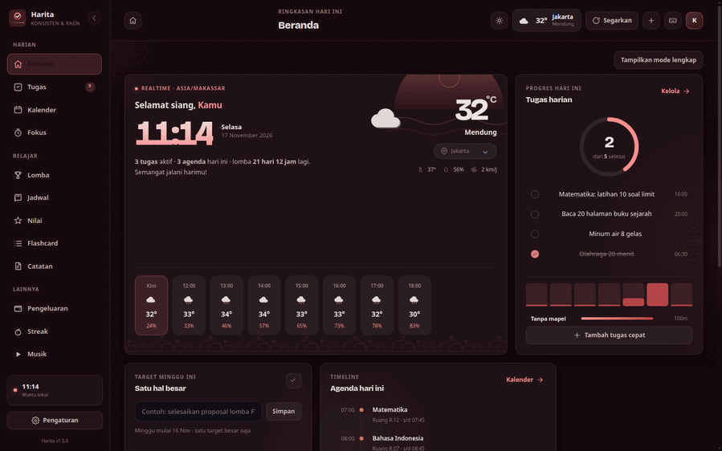
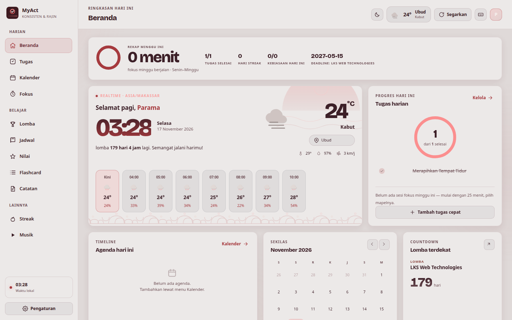

# Harita

**Konsisten & rajin setiap hari.** Harita adalah dashboard harian lokal untuk produktivitas dan kebiasaan — todo list, kalender, cuaca Indonesia realtime, lomba, pomodoro, flashcard, nilai & KKM, streak harian, dan pemantau device. Jalan sepenuhnya di laptop kamu — tanpa akun, tanpa cloud, tanpa subscription.



**Website:** https://hayoloo642-cloud.github.io/harita-project/



---

## Fitur

- **Beranda** — ringkasan hari: cuaca, tugas, agenda, kalender mini, countdown lomba, rekap mingguan
- **Cuaca realtime** — Open-Meteo (tanpa API key) untuk 16 kota Indonesia + auto refresh
- **Tugas harian** — checklist otomatis reset tiap hari, bawa tugas belum selesai, prioritas, rutinitas harian/mingguan/bulanan
- **Kalender** — agenda terkategorikan (lomba/sekolah/tugas/ujian), import/export `.ics`
- **Lomba & deadline** — countdown otomatis, checklist persiapan
- **Fokus (Pomodoro)** — 25/5/15/menit kustom, statistik per mata pelajaran, mode fokus layar penuh
- **Flashcard SM-2** — spaced repetition klasik (Anki-style) untuk belajar lebih cepat
- **Nilai & KKM** — catat nilai tiap mapel, pantau ketuntasan, cetak laporan / unduh CSV
- **Pengeluaran** — catat uang keluar, filter bulan, rincian per kategori, rata-rata harian, dan anggaran bulanan dengan progres
- **Streak & kebiasaan** — multi-habit streak dengan heatmap 112 hari
- **Music player lokal** — putar file audio di laptop, progress, volume, now-playing bar
- **Device monitor** — CPU, RAM, disk, baterai, suhu, jaringan realtime
- **Tema & tampilan** — gelap/terang/ikuti sistem, 8 aksen warna, ukuran teks, kontras tinggi, sidebar bisa diciutkan, hormati `prefers-reduced-transparency`
- **Bahasa** — antarmuka Indonesia & Inggris (chrome, navigasi, Pengaturan); ganti di Pengaturan → Bahasa
- **Keyboard first** — `Ctrl/Cmd + K` command palette, `Ctrl/Cmd + N` tugas baru, `Ctrl/Cmd + Enter` centang, `Ctrl/Cmd + D` hapus, `Alt + H` beranda, `Ctrl/Cmd + /` bantuan shortcut
- **Data contoh** — tombol "Isi data contoh" untuk melihat semua fitur tanpa mengotori data asli
- **Tugas lebih cepat** — pencarian per view, selesaikan semua + undo, edit judul inline (tugas & catatan), checklist sub-tugas, aksi massal, drag & drop urutan
- **Kalender fleksibel** — agenda berulang mingguan/bulanan, pencarian agenda, unduh `.ics`
- **Sidebar adaptif** — sematkan halaman favorit, sembunyikan item yang jarang dipakai
- **Arsip & pemulihan** — soft-delete + Undo, backup JSON otomatis, impor backup JSON dengan pratinjau per tabel, snapshot otomatis sebelum impor/restore, restore database dari backup, deteksi database korup, bersihkan cache file dari Pengaturan
- **Uji & distribusi** — smoke/stress test, Playwright E2E, skrip paket PyInstaller/AppImage/Windows/macOS, landing page offline di `docs/landing/`
- **Privasi penuh** — semua data tersimpan lokal di SQLite; tidak ada akun atau cloud

---

## Instalasi

**Prasyarat**

- Python 3.10 atau lebih baru.
- Windows installer tidak butuh Git atau admin.
- Instalasi dari source membutuhkan Git (atau download ZIP).
- Tidak ada dependency Python/JS eksternal; server memakai Python standar dan data tersimpan di SQLite lokal.

---

### Opsi 1 — Windows CMD / PowerShell (direkomendasikan)

Cara tercepat untuk install Harita di laptop Windows lain: installer otomatis mengunduh source, memasang ke `%LOCALAPPDATA%\Programs\Harita`, membuat shortcut Desktop, dan menjalankan aplikasi.

**Command Prompt**

```bat
curl.exe -L -o harita-install.ps1 https://raw.githubusercontent.com/hayoloo642-cloud/harita-project/master/install.ps1
powershell -NoProfile -ExecutionPolicy Bypass -File .\harita-install.ps1
```

**PowerShell**

```powershell
iwr -UseBasicParsing https://raw.githubusercontent.com/hayoloo642-cloud/harita-project/master/install.ps1 -OutFile harita-install.ps1
powershell -NoProfile -ExecutionPolicy Bypass -File .\harita-install.ps1
```

**Uninstall**

```powershell
.\uninstall.ps1          # hapus shortcut saja; data tetap tersimpan
.\uninstall.ps1 -RemoveData  # hapus aplikasi dan seluruh data lokal
```

> Jika kamu tidak nyaman menjalankan script dari internet, buka URL installer di atas dan baca isinya sebelum menjalankannya.

---

### Opsi 2 — Linux (Ubuntu/Debian/Fedora)

```bash
sudo apt update && sudo apt install python3 git curl   # Ubuntu/Debian
# atau: sudo dnf install python3 git curl              # Fedora

git clone https://github.com/hayoloo642-cloud/harita-project.git
cd harita-project
./run.sh
```

Buka `http://127.0.0.1:8777`.

Opsional, buat shortcut desktop Linux:

```bash
./install.sh
```

Uninstall shortcut (data tetap aman):

```bash
./uninstall.sh
```

---

### Opsi 3 — macOS

```bash
brew install python git
git clone https://github.com/hayoloo642-cloud/harita-project.git
cd harita-project
chmod +x run.sh
./run.sh
```

Buka `http://127.0.0.1:8777`.

---

### Opsi 4 — Windows tanpa Git

1. Install Python 3.10+ dari https://www.python.org/downloads/ dan centang **Add python.exe to PATH**.
2. Download source: https://github.com/hayoloo642-cloud/harita-project/archive/refs/heads/master.zip
3. Extract ZIP ke folder biasa.
4. Double-click `run.bat`, atau jalankan dari Command Prompt:

```bat
py server.py
```

5. Buka `http://127.0.0.1:8777`.

---

### Akun lokal (baru di v1.6.0+)

Saat pertama kali dibuka, Harita menampilkan layar pembuka dan meminta pendaftaran **nama + kata sandi** (sekali saja, tersimpan lokal di perangkat ini sebagai hash PBKDF2 — tidak dikirim ke mana pun).

- Pendaftaran pertama: isi nama, kata sandi, dan konfirmasi — kamu langsung masuk ke dashboard.
- Setelahnya: masukkan nama + kata sandi yang sama setiap membuka Harita.
- Ganti kata sandi / keluar: Pengaturan → **Akun**.
- Sesi tersimpan 30 hari di browser; logout kapan pun dari Pengaturan.
- Data kamu tidak pernah dihapus oleh alur ini; backup otomatis tetap berjalan (`data/backups/` + `~/harita-backups/`).
- Kata sandi dan sesi tidak pernah diekspor ke backup JSON.

### Update aplikasi

**Windows installer:** jalankan ulang perintah installer dari opsi 1; file kode diperbarui, folder `data/` dipertahankan.

**Clone source:**

```bash
./stop.sh || true
git pull
./run.sh
```

### Troubleshooting

| Masalah | Solusi |
|---|---|
| `python` atau `py` tidak dikenali | Install ulang Python dan centang **Add python.exe to PATH** |
| `permission denied` di Linux/macOS | Jalankan `chmod +x run.sh && ./run.sh` |
| Port `8777` sudah dipakai | `HARITA_PORT=8780 ./run.sh` (Windows: `set HARITA_PORT=8780 && run.bat`) |
| Aplikasi terbuka tapi kosong/404 | Jalankan dari folder `harita-project`; pastikan folder `static/` ikut ada |
| Ingin lihat log | `data/server.log` di folder aplikasi |
| Ingin pindah lokasi data | Set `HARITA_DATA`, contoh: `HARITA_DATA=/tmp/harita ./run.sh` |

### Paket biner (opsional)

Release resmi tersedia untuk:

- **Windows** — portable `.exe` atau installer `Harita-Setup-*.exe`
- **Linux** — binary raw, **AppImage**, **DEB**, dan **RPM**
- **macOS** — `.app` (`.zip`), `.dmg`, dan binary raw (Apple Silicon)

Lihat halaman Release: https://github.com/hayoloo642-cloud/harita-project/releases
Release biner dibuat dari folder [`packaging/`](packaging/README.md). Frozen build menyimpan data di folder user yang persisten dan membuka browser otomatis. Lihat [docs/RELEASE.md](docs/RELEASE.md) untuk checklist rilis.

---

## Konfigurasi environment

| Variabel | Default | Keterangan |
|----------|---------|------------|
| `HARITA_PORT` | `8777` | Port HTTP lokal (1–65535) |
| `HARITA_TZ` | timezone sistem | Contoh: `Asia/Jakarta`, `Asia/Makassar` |
| `HARITA_DATA` | `./data` | Folder data (database, cache, backup). Frozen build memakai folder data user |
| `HARITA_DB` | `$HARITA_DATA/harita.db` | Lokasi database SQLite |
| `HARITA_MUSIC` | `./music` | Folder musik lokal. Frozen build memakai `$HARITA_DATA/music` |
| `HARITA_NO_OPEN` | unset | Set `1` agar frozen build tidak membuka browser |

Contoh:
```bash
HARITA_TZ=Asia/Makassar HARITA_PORT=8780 ./run.sh
```

---

## Roadmap

Lihat [docs/ROADMAP.md](docs/ROADMAP.md) untuk rencana fitur dan status pengujian.

## Rilis

Checklist penerbitan ada di [docs/RELEASE.md](docs/RELEASE.md); build source archive dan verifikasi lokal ada di `packaging/`.

## Struktur

```
harita/
├── server.py              # HTTP server + SQLite (tanpa dependency)
├── static/                # Frontend (HTML + CSS + vanilla JS)
│   ├── index.html
│   ├── app.css
│   ├── js/
│   ├── fonts/             # Bricolage Grotesque & Space Grotesk (OFL)
│   ├── icon.svg           # logo
│   └── manifest.webmanifest
├── docs/RELEASE.md        # checklist rilis (tidak mem-publish apa pun)
├── packaging/              # PyInstaller spec + build/check scripts
├── data/                  # SQLite + cache cuaca + backups (auto-dibuat)
└── run.sh / stop.sh       # helper start/stop (Linux)
```

---

## Kontribusi

Silakan baca [CONTRIBUTING.md](CONTRIBUTING.md). Issues & PR terbuka.

## Lisensi

MIT — lihat [LICENSE](LICENSE).

## Credit

- Cuaca: [Open-Meteo](https://open-meteo.com) (CC BY 4.0) — gratis, tanpa API key
- Font: Bricolage Grotesque & Space Grotesk (SIL Open Font License)
